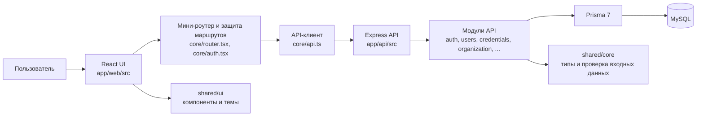

# Карта проекта

Карта показывает фактическую структуру интерфейса, маршруты, основные сценарии и расположение бизнес-логики. Состояние сверено с `app/web/src/App.tsx`, `app/web/src/Layout.tsx` и API-модулями на 28 октября 2026 года.

## 1. Как устроено приложение



Express раздаёт собранный веб-клиент и API с одного адреса. UI-маршруты описаны в `app/web/src/App.tsx`, группы бокового меню — в `app/web/src/Layout.tsx`. API собирается списком в `app/api/src/modules/index.ts`; у каждого модуля свои маршруты, контроллеры и сервисы.

## 2. Навигация и страницы

### Сотрудники

| Раздел меню | Страница | Что делает |
|---|---|---|
| Панель управления | `/admin/dashboard` или `/user/dashboard` | Сводка по удостоверениям и доступным данным |
| Список удостоверений | `/admin/overview` | Сводный обзор удостоверений в разрешённой области |
| Записи удостоверений | `/admin/credentials` | Поиск и изменение записей; действия зависят от роли |
| Удостоверения | `/user/credentials` | Просмотр и заполнение личных удостоверений |
| Радар карты, IFO | `/admin/radar-cards`, `/admin/ifo`, пользовательские аналоги | WPTS-разделы |
| Графики | `/admin/work-schedule`, `/admin/work-schedule/calendar`, `/admin/work-schedule/shift-partners`; пользовательские `/user/work-schedule*` | Годовой график, редактирование календаря и генерация сменщиков |

### Организация БПО (меню администратора)

| Пункт | UI-маршрут | Текущее назначение |
|---|---|---|
| Персонал | `/admin/org/personnel` | Справочник персонала и переключение на форму добавления |
| Добавить сотрудника | `/admin/dictionaries/employees` | Та же страница персонала, форма открывается вручную |
| Назначения | `/admin/org/assignments` | Страница организационной структуры: назначения сотрудников, базы и месторождения |
| Переводы | `/admin/org/transfers` | Сейчас открывает ту же страницу организационной структуры; отдельного процесса принятия перевода пока нет |
| Договоры | `/admin/org/contracts` | Создание договоров/допсоглашений, основания по скважинам, разрешения и регистрация работ |
| Месторождения и скважины | `/admin/organization` | Создание объектов, скважин, назначение координатора месторождения |

**Замечание:** отдельные названия в меню пока не означают отдельные реализации. «Переводы» и «Назначения» используют одну страницу; «Договоры» — одну страницу с несколькими большими блоками. Это текущее состояние UI, а не заявка на уже завершённое разбиение.

### Справочники и общие разделы

| Раздел | UI-маршрут | Функции |
|---|---|---|
| Базы | `/admin/dictionaries/bases` | Создание, редактирование и архивирование баз |
| Статусы и виды работ | `/admin/dictionaries/organization` | Справочники статусов, заказчиков и видов работ |
| Должности | `/admin/positions` | Справочник должностей |
| Удостоверения | `/admin/catalog` | Названия удостоверений и срок их действия |
| Уведомления | `/admin/notifications`, `/user/notifications` | Центр уведомлений |
| Сообщения | `/admin/messages` | Личные и групповые сообщения |
| Аудит | `/admin/audit-log` | Журнал изменений |
| Профиль | `/user/profile` | Контактные данные и профиль |
| Настройки интерфейса | `/settings` | Персональная цветовая тема (6 вариантов) |

Оборудование пока ведёт на страницу-заготовку `/admin/equipment`.

## 3. Основные пользовательские сценарии

### Вход и учётная запись

1. Пользователь входит по логину и паролю.
2. Сервер проверяет учётную запись и выдаёт access-токен; refresh хранится в `httpOnly` cookie.
3. При временном пароле интерфейс направляет пользователя на `/change-password`.
4. Роль проверяется на сервере; `Protected` в UI лишь скрывает недоступные экраны и не является границей безопасности.

### Создание персонала и назначение

1. Откройте «Организация БПО → Добавить сотрудника».
2. Заполните ФИО и логин, выберите полевой TRS или цеховой R&M тип, роль, должность, базу, руководителя и дату.
3. Сохранение сейчас выполняет последовательность запросов: создание учётной записи → получение карточки Employee → установка системной роли → создание назначения.
4. Для нового сотрудника используется временный пароль `user12345`.

**Ограничение:** текущая форма доступна в UI администратора. Менеджер не может создавать учётные записи через неё, так как соответствующий API закрыт для менеджерской роли. Последовательность запросов не атомарна: если поздний запрос завершится ошибкой, ранее созданные данные нужно проверить и завершить вручную.

### Назначение персонала и координатора

- Карточка `Employee` привязана к `User`; активное кадровое назначение хранит базу, должность, трек TRS/R&M, руководителя и дату.
- Назначение координатора на месторождение сохраняет историю и проверяет его активную роль и базу.
- Перевод сотрудника через текущую страницу создаёт назначение и уведомления; менеджерский сценарий «запрос → уведомление принимающему менеджеру → принятие → выбор координатора» пока не реализован.

### Договоры и выполнение работ

1. Убедитесь, что созданы база, месторождение и скважины.
2. На `/admin/org/contracts` выберите базу и заказчика, создайте договор.
3. При необходимости добавьте допсоглашение.
4. Выберите договор или допсоглашение, месторождение и скважины; закрепите основание за одной или несколькими скважинами на заданный период.
5. Настройте разрешённые виды работ и зарегистрируйте выполненную работу.
6. API проверяет доступ к базе и наличие единственного действующего основания на дату работ, периоды, статусы и разрешения.

Один договор или допсоглашение можно связать с несколькими скважинами через массовую форму. Массовая операция выполняет последовательные запросы, поэтому при ошибке часть привязок может уже сохраниться.

### Удостоверения

- Список доступных видов удостоверений ведётся администратором в каталоге.
- Сотрудник вводит номер и дату выдачи; окончание вычисляется по сроку из каталога.
- Фото/сканы доступны владельцу и администраторам.
- Состояние рассчитывается по сроку действия; уведомления и сводки обслуживает модуль notifications.

## 4. Роли и область данных

`User.role` (ADMIN/USER) сохраняется как совместимый уровень учётной записи. Дополнительные бизнес-роли хранятся отдельно в `UserSystemRole`: менеджер, координатор, старший механик, механик, мастер цеха и другие.

| Роль | Область по текущей модели |
|---|---|
| Администратор | Управление пользователями, справочниками и всеми базами |
| Менеджер | Операции в своей базе: договоры, месторождения, назначения в рамках разрешённых правил |
| Координатор | Назначенные месторождения и команда |
| Старший механик | Глобальная роль R&M компании; в базе данных ограничивается одним активным назначением |
| Механик / мастер цеха | Команда R&M в пределах назначений |
| Сотрудник | Собственные удостоверения, профиль, уведомления и доступные рабочие разделы |

Права маршрутов и бизнес-операций нужно сверять отдельно: наличие ссылки в меню само по себе не означает доступ или готовую функцию.

## 5. Основные API и данные

| API-префикс | Область |
|---|---|
| `/api/auth` | Вход, обновление и завершение сессии |
| `/api/me` | Собственный профиль и настройки; уведомления находятся по `/api/me/notifications` |
| `/api/admin/users` | Административный справочник учётных записей |
| `/api/admin/credentials`, `/api/me/credentials`, `/api/credentials` | Управление удостоверениями, личные записи и фото |
| `/api/org` | Базы, персонал, назначения, месторождения, скважины, договоры и работы |
| `/api/admin/org` | Административные роли, базы и справочники организации |
| `/api/notifications`, `/api/messages` | Уведомления и сообщения |
| `/api/admin/work-schedule`, `/api/me/work-schedule` | Графики |
| `/api/admin/messages` | Сообщения администратора |

Основные сущности организации находятся в `app/api/prisma/schema.prisma`: `User`, `Employee`, `EmployeeAssignment`, `Base`, `Mine`, `Well`, `MineCoordinatorAssignment`, `Customer`, `Contract`, `ContractAddendum`, `WellContractBasis`, `WorkExecution` и связанные справочники. История назначений не заменяется текущим состоянием: закрытые записи остаются в базе.

## 6. Где искать код

| Задача | Путь |
|---|---|
| Маршруты и право входа в UI | `app/web/src/App.tsx` |
| Боковая навигация | `app/web/src/Layout.tsx` |
| Сессия и роли UI | `app/web/src/core/auth.tsx` |
| API-клиент | `app/web/src/core/api.ts` |
| Загрузка и обновление данных страниц | `app/web/src/core/data.ts` |
| Страницы функций | `app/web/src/modules/` |
| Организационные API-маршруты | `app/api/src/modules/organization/index.ts` |
| Контроллеры и правила организации | `app/api/src/modules/organization/organization.controller.ts`, `organization.service.ts` |
| Проверка входа, ролей и области данных | `app/api/src/core/auth.ts`, `app/api/src/core/module.ts`, `organization.service.ts` |
| Схема и миграции | `app/api/prisma/schema.prisma`, `app/api/prisma/migrations/` |
| Общие типы и схемы валидации | `shared/core/` |
| Компоненты и стили UI | `shared/ui/` |

## 7. Запуск и проверка

```powershell
npm install
npm run db:up
npm run migrate:deploy -w @app/api
npm run db:seed
npm run dev
```

Приложение доступно на `http://localhost:4100`. Для демонстрационных данных используется `npm run db:demo`; запускайте её только на локальной/тестовой базе.

```powershell
npm run typecheck
npm run build
npm test
```

Интеграционные API-тесты требуют отдельную тестовую MySQL-базу. Перед применением миграций на рабочей базе сделайте резервную копию; не запускайте `db:reset` или `migrate reset` на базе с нужными данными.

## 8. Реализовано и требует продолжения

**Работает:** вход и роли API, справочники удостоверений/должностей/баз/организации, учёт удостоверений, фото, графики, уведомления, сообщения, аудит, создание объектов и скважин, назначения координаторов, договора, допсоглашения и контроль регистрации работ.

**Требует отдельной реализации или завершения:** процесс принятия переводов менеджером принимающей базы; создание учётной записи менеджером; отдельные UI-страницы для переводов, назначений и договорного процесса; атомарная массовая привязка договора к нескольким скважинам; полноценный модуль оборудования; пункты расписания для событий, отсутствий, согласований и интеграций.
