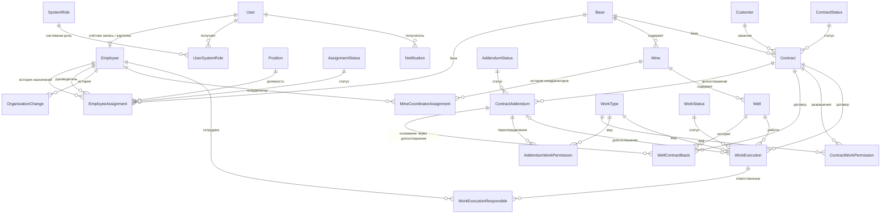

# Учёт удостоверений сотрудников

Веб-приложение для учёта удостоверений сотрудников и контроля сроков их действия.

**Стек:** React + TypeScript · Node.js + Express · Prisma · MySQL · JWT.

## Структура

```
app/                          самостоятельные приложения
  api/                        сервер API (Express + Prisma)
    src/
      core/                   инфраструктура: конфиг, БД, авторизация, журнал, почта, JWT, ошибки
      modules/                функциональные модули — у каждого свои маршруты, контроллер и сервис
        auth/  users/  credentials/  catalog/  positions/  organization/
        notifications/  messages/  dashboard/  overview/  audit/
        index.ts              список подключённых модулей
      app.ts                  сборка приложения из модулей
      server.ts               запуск: один процесс или кластер на все ядра
    prisma/                   схема, миграции, начальные и демо-данные
    tests/
  web/                        веб-интерфейс (React)
    src/
      core/                   API-клиент, роутер, авторизация, загрузка данных, формы
      modules/                страницы и компоненты по модулям (те же, что на сервере, + profile)
      App.tsx  Layout.tsx  main.tsx
shared/                       общее для нескольких модулей и приложений
  core/                       типы, схемы и валидация, расчёт сроков и статусов, подписи журнала
  ui/                         UI-кит: поля, диалоги, иконки, бейджи статусов, стили
  config/                     общий tsconfig
```

Правила:

- **Модуль — это папка.** На сервере модуль экспортирует свои маршруты и фоновые задачи (`AppModule` в `app/api/src/core/module.ts`). Новый модуль — новая папка и строка в `modules/index.ts`.
- **`shared` не зависит от приложений.** В нём только то, что нужно нескольким модулям или обоим приложениям. Код, общий для модулей одного приложения, но завязанный на это приложение (API-клиент, роутер), лежит в его `src/core`.
- **Импорт общего кода:** `@app/shared` и `@app/shared/ui`.

## Зависимости — только необходимое

| Где | Пакеты |
|---|---|
| `app/api` | `express`, `@prisma/client` (+ `prisma` CLI для миграций) |
| `app/web` | `react`, `react-dom` (+ `esbuild` для сборки) |
| Общее | `typescript` — только проверка типов; типы `@types/*` |

Всё остальное — встроенные возможности Node.js или несколько строк своего кода:

- TypeScript запускает сам Node (type stripping) — без tsx/ts-node, поэтому в импортах указаны расширения `.ts`;
- тесты — `node:test` и `fetch`, перезапуск при изменениях — `node --watch`, переменные окружения — `--env-file`;
- кластер на все ядра — `node:cluster`, пароли — scrypt из `node:crypto`, JWT (HS256) — `app/api/src/core/jwt.ts`;
- валидация — `shared/core/validation.ts` (одна и та же схема на клиенте и сервере);
- интерфейс — UI-кит в `shared/ui`, мини-роутер и загрузка данных в `app/web/src/core`;
- клиент раздаёт тот же Express-сервер: один адрес, без CORS и прокси.

## Запуск для разработки

Нужны Node.js 22.18+ (или 23.6+) и Docker.

```bash
npm install
npm run db:up                              # MySQL 8 в Docker, порт 3308
cp app/api/.env.example app/api/.env       # если .env ещё нет
npm run db:migrate                         # создать таблицы
npm run db:seed                            # первый администратор + справочник
npm run dev                                # http://localhost:4100 — сервер и интерфейс
```

В режиме `dev` клиент пересобирается при изменениях (страницу в браузере нужно обновить), сервер перезапускается сам.

Первый вход: логин и пароль из `SEED_ADMIN_LOGIN` / `SEED_ADMIN_PASSWORD` в `app/api/.env`
(по умолчанию `admin` / `admin12345`). При первом входе система попросит сменить пароль.

Новым пользователям и при сбросе пароля подставляется временный пароль `user12345`
(`DEFAULT_TEMP_PASSWORD` в `shared/core/schemas.ts`); при первом входе его нужно сменить.

## Продакшен

```bash
npm start      # сборка интерфейса и запуск сервера
```

В `app/api/.env` укажите `NODE_ENV=production` и свои `JWT_*`, `DATABASE_URL`, `SMTP_*`, `APP_URL`.

**Многоядерный режим.** При `NODE_ENV=production` сервер запускает по рабочему процессу на каждое ядро
(`node:cluster`). Процессы делят один порт, запросы раздаются по кругу, упавший процесс сразу перезапускается.
Фоновые задачи (проверка сроков и письма) идут только в одном процессе. Число процессов задаётся `CLUSTER_WORKERS`.

Учтите:
- у каждого процесса свой пул соединений с MySQL (параметр `connection_limit` в `DATABASE_URL`);
- ограничение попыток входа считается отдельно в каждом процессе.

## Почта

Сотрудник с указанным email получает письмо, когда у его удостоверения срок становится жёлтым или красным
(пороги 90 / 30 / 10 / 0 дней, без повторов). Администраторы с email — раз в день сводку по всем красным и жёлтым.
Отправка идёт через свой SMTP-клиент (`app/api/src/core/smtp.ts`): TLS или STARTTLS, вход по логину и паролю.

Настройки — переменные `SMTP_*` и `APP_URL` в `app/api/.env`. Если `SMTP_HOST` пустой, письма не отправляются.
Для локальной проверки есть Mailpit: `docker compose up -d mailpit`, письма видны на http://localhost:8026.

## Фото удостоверений

JPG, PNG, WebP или PDF до 5 МБ. Тип проверяется по содержимому файла. Файлы лежат в `app/api/uploads/credentials/`
(эту папку нужно включить в резервное копирование), а отдаются только владельцу и администраторам.

## Демо-данные

```bash
npm run db:demo                       # добавить демо-данные к текущей базе
npm run db:reset && npm run db:demo   # пересоздать базу с нуля и загрузить демо
```

Пароль всех демо-пользователей — `DEMO_PASSWORD` в `app/api/prisma/seed-demo.ts`.

| Логин | Кто | Что посмотреть |
|---|---|---|
| `kovaleva` | Администратор | Дашборд, общие сведения, журнал, уведомления по всем сотрудникам |
| `petrov` | Мастер участка | Просроченное удостоверение, личное сообщение |
| `ivanov` | Электромонтёр | Красное, жёлтое и зелёные удостоверения |
| `novikov` | Водитель погрузчика | Истекает сегодня, пограничные сроки 10 / 11 / 89 / 95 дней |
| `morozova` | Лаборант (новичок) | Смена временного пароля при входе, все удостоверения не заполнены |
| `sidorova` | Инженер по ОТ | Почти всё зелёное, уведомления прочитаны |
| `fedorov` | Электрогазосварщик | Заблокирован: войти нельзя |

## Тесты

```bash
npm test            # unit-тесты shared + интеграционные тесты API (нужен запущенный MySQL)
npm run typecheck   # проверка типов всех частей
```

Интеграционные тесты работают с отдельной БД `credentials_test` (`app/api/.env.test`) и пересоздают её перед прогоном.

## Основные правила

| Правило | Где реализовано |
|---|---|
| Статус по дате окончания: > 90 дн. — зелёный, 11–90 — жёлтый, ≤ 10 и истёкшие — красный, нет даты — белый | `shared/core/status.ts` |
| Дни считаются по московскому времени | `shared/core/dates.ts` |
| Сотрудник вводит только дату выдачи; дата окончания = выдача + срок из справочника, считается на сервере | `modules/credentials/credentials.service.ts` |
| Изменение срока в справочнике не пересчитывает уже введённые даты | `modules/catalog/catalog.service.ts` |
| Новая позиция справочника сразу появляется у всех сотрудников; у администраторов удостоверений нет | `ensureUserCredentials`, `backfillCatalogItem` |
| Пометка на удаление: запись скрыта из списков и статистики, восстанавливается | `adminMark` / `adminUnmark` |
| Пользователи удаляются мягко (`isDeleted`), логин остаётся занятым | `modules/users/users.service.ts` |
| Права проверяются на сервере; `userId` для `/api/me/*` берётся только из токена | `core/auth.ts`, `core/module.ts` |
| Блокировка, смена роли или пароля сразу отзывают токены (`tokenVersion`) | `core/auth.ts`, `users.service.ts` |
| Все изменения пишутся в журнал с «было/стало» | `core/audit.ts` |
| Уведомления о сроках: ежедневно в 08:00 МСК и при старте; копии красных и жёлтых — администраторам | `modules/notifications/` |

## Организационная структура TRS и договорные работы

Новая схема добавляется миграцией `app/api/prisma/migrations/20261026230000_trs_data_model`.
Она сохраняет старые таблицы и историю миграций, создаёт карточки `Employee` для всех существующих
`User`, переносит `positionId` в текущее назначение и сохраняет старую системную роль как отдельное
назначение. Базу, подразделение и руководителя старых пользователей миграция намеренно не угадывает:
импортированное назначение имеет трек `UNASSIGNED`, а организационные назначения нужно заполнить после
уточнения штатной структуры.

Применение на рабочей базе:

```bash
npm run migrate:deploy -w @app/api
```

Не используйте
`db:reset`, `migrate reset` или `db push --force-reset` на базе с данными. Перед production-релизом
сделайте резервную копию и сначала примените миграцию к восстановленной копии базы.

### ER-модель



`User` остаётся границей входа и совместимости существующих API; `Employee` хранит кадровую идентичность.
`EmployeeAssignment` отдельно сохраняет должность, базу, руководителя, трек TRS/R&M, статус, причину,
инициатора и даты. Для каждой сущности активная запись защищена nullable unique-ключом, а прошлые
назначения и связи с месторождениями/основаниями сохраняются. Статусы — отдельные расширяемые справочники
с архивированием; встроенные коды используются как начальные бизнес-состояния.

Новые API доступны под `/api/org`: базы и объекты, назначения сотрудников и координаторов, договоры,
допсоглашения, привязка договорного основания к скважине, проверка разрешения и регистрация работы.
`/api/admin/org` управляет базами, ролями, справочниками статусов и видами работ. В интерфейсе добавлены
разделы «Оргструктура TRS / R&M» и «Договоры и работы»: администратор назначает сотрудникам системные
роли, должности, базы и руководителей, заводит справочники заказчиков/видов работ; менеджер видит и
изменяет только объекты своей базы. Координатор видит назначенные ему месторождения и свою команду, но
не получает доступа к договорному управлению. Проверка работы отказывает, если нет единственного
действующего основания, договор/допсоглашение не действует или необходимое разрешение отсутствует;
разрешение допсоглашения может как запретить, так и разрешить вид работ поверх основного договора.

**Архитектурные решения и оставшийся объём.** Старые `User.role` и `User.positionId` оставлены для
совместимости: должность теперь также фиксируется в назначении, а новые системные роли живут отдельно
и имеют собственную историю. Миграция переносит администраторов как `ADMIN`, остальных как `EMPLOYEE`,
но не повышает пользователей до управленцев по названию должности. Для старой незаполненной записи
разрешено заменить `UNASSIGNED` назначением той же датой; новое назначение в ту же дату поверх уже
оформленного считается конфликтом, чтобы не переписывать кадровую историю. Назначение R&M и контроль
статусов проверяются на backend. До запуска в production необходимо проверить миграцию на восстановленной
копии базы, заполнить реальные назначения и согласовать, какие штатные должности соответствуют ролям
R&M. Проверка доступов старых модулей приложения пока продолжает использовать совместимые `User.role`
(ADMIN/USER), поэтому единая матрица TRS/R&M для всех прежних API и экранов остаётся отдельным этапом,
а не автоматически применяется ко всем существующим маршрутам.
